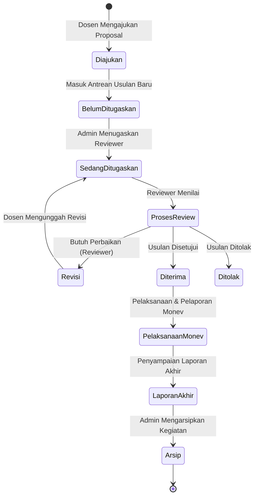
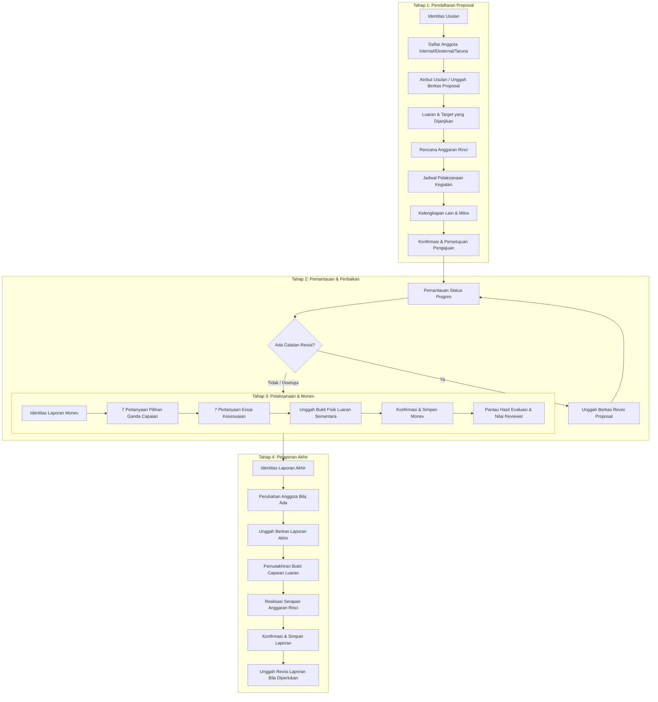
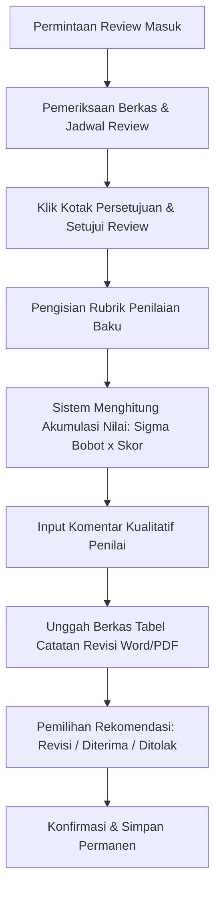
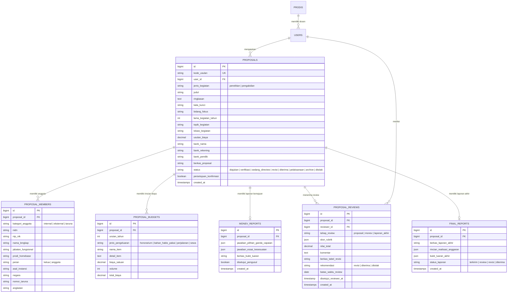
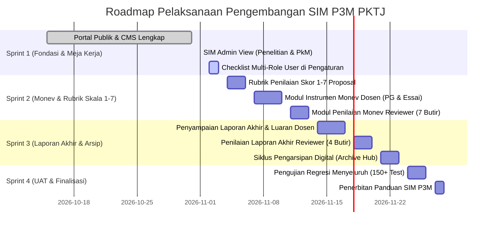

# PRODUCT REQUIREMENT DOCUMENT (PRD)
## SISTEM INFORMASI MANAJEMEN PENELITIAN DAN PENGABDIAN KEPADA MASYARAKAT (SIM P3M) & PORTAL WEB P3M
### POLITEKNIK KESELAMATAN TRANSPORTASI JALAN (PKTJ) TEGAL

---

## 1. DOKUMEN KONTROL & METADATA

| Atribut | Keterangan |
|---|---|
| **Nama Dokumen** | Product Requirement Document (PRD) SIM P3M PKTJ |
| **Kode Dokumen** | PRD-SIM-P3M-PKTJ-2026-V1.0 |
| **Versi Dokumen** | Versi 1.0 (Definisi Lengkap Spesifikasi 20 Halaman PDF Kebutuhan) |
| **Tanggal Terbit** | 1 November 2026 |
| **Status Dokumen** | Disetujui sebagai Panduan Pengembangan Utama (*Approved Baseline*) |
| **Pemilik Sistem** | Pusat Penelitian dan Pengabdian kepada Masyarakat (P3M) PKTJ |
| **Target Pengguna** | Masyarakat Umum, Dosen Peneliti PKTJ, Reviewer Internal PKTJ, Tim Administrasi P3M |
| **Lingkungan Teknis** | Laravel 11, PHP 8.2+, MySQL / MariaDB, Tailwind CSS (4px Strict Grid), Alpine.js |

---

## 2. RINGKASAN EKSEKUTIF & TUJUAN PRODUK

### 2.1 Latar Belakang
Politeknik Keselamatan Transportasi Jalan (PKTJ) Tegal sebagai institusi pendidikan tinggi vokasi di bawah naungan Badan Pengembangan Sumber Daya Manusia Perhubungan (BPSDMP), Kementerian Perhubungan RI, memerlukan satu kesatuan sistem digital yang terintegrasi untuk:
1. **Publikasi & Akuntabilitas Publik**: Menyajikan profil kelembagaan, renstra, roadmap, direktori peneliti, statistik kegiatan riset dan pengabdian, luaran berlisensi terbuka, serta dokumen panduan kelembagaan kepada pemangku kepentingan eksternal dan akreditasi institusi.
2. **Tata Kelola Siklus Hidup Kegiatan Akademik (SIM P3M)**: Mengotomatisasi seluruh siklus pengajuan proposal, penugasan reviewer oleh admin, penilaian berbasis rubrik standar berbobot dengan skala skor 1–7, pemantauan berkala (*Monev*), penyampaian laporan akhir kegiatan, hingga proses pengarsipan digital (*Archive*).

### 2.2 Visi & Sasaran Produk
Menghadirkan sistem informasi yang andal, transparan, tertata, dan humanis yang:
- Mengeliminasi proses administratif manual berbasis kertas.
- Mendukung mobilitas dosen dan reviewer melalui antarmuka responsif di semua perangkat (ponsel cerdas, tablet, laptop, dan komputer kerja).
- Memastikan keterlacakan data 100% dari tahap usulan hingga arsip (*end-to-end traceability*).
- Menjaga kepatuhan pada 3 Program Studi di Lingkungan PKTJ: **D4 Rekayasa Sistem Transportasi Jalan (RSTJ)**, **D4 Teknologi Rekayasa Otomotif (TRO)**, dan **D3 Teknologi Otomotif (TO)**.

---

## 3. ARSITEKTUR PENGGUNA & MATRIKS HAK AKSES (RBAC)

Sistem melayani 4 tipe pengguna utama dengan arsitektur peran berbasis multi-role (*Role-Based Access Control*):

| Peran Pengguna | Deskripsi & Batasan Akses | Ruang Lingkup Hak Akses |
|---|---|---|
| **Publik / Tamu** | Masyarakat umum, calon mitra, akademisi eksternal, dan asesor akreditasi. | Akses *read-only* ke portal informasi publik: Beranda, Profil P3M, Riset, Pengabdian, Layanan Dokumen & SOP, serta Tautan Jurnal Ilmiah P3M. |
| **Dosen Peneliti** | Seluruh dosen tetap internal di lingkungan civitas akademika PKTJ. | Pengajuan usulan (Penelitian/PkM), pengelolaan tim anggota (internal, eksternal, mahasiswa), penyusunan anggaran rinci, pengunggahan revisi usulan, pengisian instrumen Monev (PG & Essai), penyampaian Laporan Akhir, dan pemantauan status progres. |
| **Reviewer Internal** | Dosen berkeahlian khusus yang ditunjuk oleh Kepala P3M / Admin untuk menilai usulan. | Menerima permintaan review, menyetujui jadwal telaah, memberikan penilaian objektif berbasis rubrik baku dan bobot persentase pada skala skor (1, 2, 3, 5, 6, 7), mengunggah tabel revisi, dan memberikan rekomendasi penetapan. Dosen dapat berperan ganda sebagai Peneliti sekaligus Reviewer untuk usulan berbeda. |
| **Administrator P3M** | Staf pengelola operasional dan manajemen sistem P3M PKTJ. | Manajemen konten portal publik (CMS), penugasan reviewer untuk setiap proposal/monev/laporan masuk, pemantauan tahapan siklus hidup proposal (7 tahapan), pengarsipan kegiatan selesai, dan manajemen penetapan hak peran (*User & Roles*). |

---

## 4. SPESIFIKASI MODUL 1: PORTAL WEB PUBLIK & CMS P3M (PDF Hal. 1–2)

Modul Portal Publik berfungsi sebagai etalase institusi P3M PKTJ yang dapat dikelola secara penuh oleh Administrator melalui panel CMS (*Content Management System*).

```mermaid
graph TD
    PublicPortal[Portal Web P3M PKTJ]
    PublicPortal --> M1[1. Beranda / Homepage]
    PublicPortal --> M2[2. Profil]
    PublicPortal --> M3[3. Riset]
    PublicPortal --> M4[4. Pengabdian]
    PublicPortal --> M5[5. Layanan]
    PublicPortal --> M6[6. Jurnal Ilmiah]
    PublicPortal --> M7[7. Pintu Masuk SIM / Login]

    M1 --> M1_1[Tentang P3M, Video Profil, Berita Terkini]
    M2 --> M2_1[Renstra Penelitian & PkM 2026-2031]
    M2 --> M2_2[Roadmap Penelitian]
    M2 --> M2_3[Visi, Misi & Tujuan]
    M2 --> M2_4[Profil Peneliti & Publikasi Dosen]
    M2 --> M2_5[Sumber Daya Manusia / Struktur Organisasi]
    M3 --> M3_1[Kegiatan Penelitian: Filter Prodi, Sumber Dana, Tahun]
    M3 --> M3_2[Luaran Penelitian: Publikasi, HKI, Produk/Jasa Berlisensi Terbuka]
    M3 --> M3_3[Kerjasama Penelitian Tersusun per Tahun]
    M4 --> M4_1[Kegiatan PkM: Filter Prodi, Sumber Dana, Tahun]
    M4 --> M4_2[Luaran PkM: Analisis Kebermanfaatan]
    M4 --> M4_3[Kerjasama PkM Tersusun per Tahun]
    M5 --> M5_1[Panduan & Pedoman: 4 Kategori Dokumen Utama]
    M5 --> M5_2[SOP: Terpisah SOP Penelitian vs SOP Pengabdian]
```

### 4.1 Rincian Fitur Portal Publik

#### 4.1.1 Menu Beranda (Homepage)
- **Komponen Tampilan**:
  - Ringkasan profil dan mandat institusi P3M PKTJ.
  - Pemutar video profil kelembagaan P3M (dukungan YouTube *embed* & MP4 lokal).
  - Warta terkini, artikel ilmiah populer, dan pengumuman kegiatan akademik.
- **CMS Admin**: Pengaturan teks sambutan, pembaruan URL/file video profil, manajemen pos berita (*CRUD*).

#### 4.1.2 Menu Profil
1. **Rencana Strategis (Renstra)**:
   - Unduhan berkas panduan: *Dokumen Renstra Penelitian 2026–2031* dan *Dokumen Renstra Pengabdian Kepada Masyarakat*.
   - Pelacak jumlah unduhan (*download counter*).
2. **Roadmap Penelitian**:
   - Berkas *Peta Jalan (Roadmap) Penelitian PKTJ*, visualisasi bagan tahapan riset unggulan keselamatan jalan.
3. **Visi, Misi & Tujuan**:
   - Penyajian teks visi, misi, dan tujuan strategis kelembagaan P3M yang terintegrasi dengan rencana induk pengembangan PKTJ.
4. **Profil Peneliti**:
   - Direktori seluruh dosen aktif di 3 Program Studi di lingkungan PKTJ (D4 RSTJ, D4 TRO, D3 TO).
   - Menampilkan biodata kepakaran, jabatan fungsional, riwayat kegiatan penelitian yang didanai, dan daftar publikasi ilmiah dosen.
   - Filter pencarian berbasis nama dosen, NIDN/NIP, dan prodi asal.
5. **Sumber Daya Manusia (SDM)**:
   - Bagan visual struktur organisasi P3M (Kepala P3M, Sekretaris, Koordinator Bidang Penelitian, Koordinator Bidang Pengabdian, Staf Administrasi).
   - Pengaturan hierarki dan penanggung jawab melalui CMS.

#### 4.1.3 Menu Riset
1. **Kegiatan Penelitian**:
   - Daftar kegiatan penelitian dosen yang didanai berdasarkan sumber dana (DIPA PKTJ, BPSDMP, Kemendikbudristek, Kerjasama Industri/Mitra, Mandiri).
   - Tersusun kronologis per tahun anggaran.
   - Panel visualisasi statistik berupa grafik batang dan tabel data yang dapat difilter secara interaktif per program studi dan per tahun.
   - Unduhan laporan ringkas penelitian (PDF).
2. **Luaran Penelitian**:
   - Terbagi dalam 3 kategori luaran: **Publikasi Ilmiah** (Jurnal Nasional bereputasi/Sinta, Jurnal Internasional/Scopus), **Hak Kekayaan Intelektual (HKI)** (Paten, Hak Cipta perangkat lunak/manual keselamatan), dan **Produk/Jasa** (purwarupa alat keselamatan, modul rekayasa, teknologi tepat guna).
   - Indikator khusus: Mengadopsi lisensi terbuka, keberlanjutan hasil riset, kemanfaatan bagi keselamatan transportasi jalan nasional, dan realisasi serapan anggaran.
3. **Kerjasama Penelitian**:
   - Daftar kemitraan riset dengan instansi pemerintah, BUMN transportasi, dan dunia industri (DUDI) yang tersusun per tahun anggaran beserta dokumen pendukung (MoU/PKS).

#### 4.1.4 Menu Pengabdian
1. **Pengabdian Kepada Masyarakat (PkM)**:
   - Daftar kegiatan pengabdian dosen dan taruna tersusun per tahun dan sumber dana.
   - Fitur grafik statistik serta tabel dinamis dengan filter program studi dan tahun pelaksanaan.
2. **Luaran Pengabdian**:
   - Hasil analisis dampak dan evaluasi kemanfaatan kegiatan PkM terhadap peningkatan kesadaran keselamatan jalan masyarakat, mitra binaan, dan komunitas sekolah.
3. **Kerjasama Pengabdian**:
   - Rekam jejak kemitraan pelaksanaan PkM beserta data pendukungnya tersusun per tahun.

#### 4.1.5 Menu Layanan
1. **Panduan dan Pedoman**:
   - Menghimpun 4 kategori dokumen induk:
     - *Pedoman Penelitian dan Pengembangan Sumber Daya Manusia*
     - *Pedoman Pengabdian kepada Masyarakat dan Pengembangan Kualitas Kepakaran*
     - *Proses Pengabdian kepada Masyarakat*
     - *Panduan Penggunaan Sistem Informasi (SIM P3M)*
   - Filter tab kategori dokumen, pencarian kata kunci, dan pengunduh PDF.
2. **Standar Operasional Prosedur (SOP)**:
   - Pemisahan tegas antara kelompok **SOP Bidang Penelitian** dan **SOP Bidang Pengabdian Masyarakat**.

#### 4.1.6 Menu Jurnal & Pintu Masuk SIM
- **Jurnal**: Tautan langsung (*external link*) menuju portal jurnal ilmiah PKTJ (https://ktj.pktj.ac.id/).
- **Pintu Masuk Login**: Tautan menuju gerbang otentikasi SIM P3M bagi dosen, reviewer, dan administrator.

---

## 5. SPESIFIKASI MODUL 2: SISTEM INFORMASI MANAJEMEN - TAMPILAN ADMINISTRATOR (ADMIN VIEW) (PDF Hal. 3–4)

Administrator memiliki tanggung jawab sentral dalam mengorkestrasi penugasan reviewer, mengawal seluruh tahapan pengajuan dari *submission* hingga *archive*, serta mengatur hak akses pengguna.

### 5.1 Struktur Navigasi Administrator
Panel kerja Administrator mengusung arsitektur menu terstruktur:
1. **Autentikasi Aman**: Input Nama Pengguna (Email kedinasan / NIDN) dan Kata Sandi. Proteksi ketat via middleware `auth` dan peran `admin`.
2. **Beranda (Home Hub)**: Menampilkan 3 Kartu Pilihan Utama:
   - **Modul Penelitian**: Akses langsung ke meja kerja usulan riset.
   - **Modul Pengabdian kepada Masyarakat**: Akses langsung ke meja kerja usulan PkM.
   - **Modul Pengaturan**: Konfigurasi akun, peran pengguna, dan parameter sistem.
   - **Visualisasi Pipeline 7 Tahapan**: Monitor agregat (*Diajukan*, *Verifikasi*, *Sedang Direview*, *Revisi*, *Diterima*, *Pelaksanaan*, *Arsip*).
   - **Tabel Aksi Cepat**: Menampilkan usulan baru yang belum menerima penugasan reviewer.

### 5.2 Alur Meja Kerja Penelitian & Pengabdian (Admin View)
Tampilan meja kerja Penelitian (`/admin/penelitian`) dan Pengabdian (`/admin/pengabdian-masyarakat`) memiliki tata letak simetris dengan 4 tab operasional:

| Tab Operasional | Fungsi & Data yang Ditampilkan | Aksi Administrator |
|---|---|---|
| **1. Daftar Usulan & Laporan Masuk** | Menampilkan seluruh berkas yang diajukan oleh dosen. Terdiri dari 3 jenis berkas: **Proposal**, **Monev**, dan **Laporan Kegiatan**. | Memeriksa kelengkapan berkas, mengunduh lampiran, dan memverifikasi administrasi. |
| **2. Belum Ditugaskan** | Menyaring usulan yang sudah masuk namun belum memiliki penelaah (*unassigned reviewer*). | Memilih judul usulan, membuka modal penugasan, memilih dosen reviewer internal yang kompeten, menetapkan tenggat waktu, dan mengirimkan tugas penelaahan. |
| **3. Sedang Ditugaskan** | Menampilkan usulan yang sedang berada dalam proses telaah reviewer aktif. | Memantau tahapan setiap berkas, melihat riwayat komunikasi telaah, dan mengecek batas waktu respons penilai. |
| **4. Arsip (Archive)** | Menampung seluruh kegiatan yang telah melewati seluruh siklus (laporan akhir telah disetujui, luaran lengkap, dan anggaran dipertanggungjawabkan). | Menandai usulan selesai menjadi arsip permanen, mencetak rekapitulasi capaian, dan mengunduh bundel laporan akhir. |

### 5.3 Modul Pengaturan (User & Roles)
- **Daftar Pengguna**: Menampilkan seluruh pengguna yang terdaftar dalam basis data sistem beserta email, nama lengkap, NIDN/NIP, dan prodi.
- **Manajemen Multi-Role Dinamis**:
  - Administrator dapat menentukan peran setiap pengguna dengan mencentang kotak pilihan (*checkbox*): `[ ] Admin`, `[ ] Reviewer`, `[ ] Peneliti`.
  - **Satu pengguna dapat memiliki lebih dari satu peran secara simultan** (contoh: seorang dosen dapat berstatus sebagai Peneliti aktif sekaligus ditugaskan sebagai Reviewer untuk usulan bidang lain).
  - Tombol Simpan Peran memperbarui hak akses pengguna secara instan tanpa perlu mendaftar ulang.

---

## 6. SPESIFIKASI MODUL 3: SISTEM INFORMASI MANAJEMEN - TAMPILAN PENELITI (PENELITI VIEW) (PDF Hal. 5–14)

Dosen internal PKTJ memiliki kewenangan penuh untuk mengelola siklus pengajuan usulan, instrumen pemantauan (*monev*), dan pelaporan akhir untuk skema **Penelitian** maupun **Pengabdian kepada Masyarakat**.

### 6.1 Formulir Terstruktur Pendaftaran Proposal (8 Tahapan Step-by-Step)

#### 1. Identitas Usulan
- **Jenis Kegiatan**: Pilihan radio: `Penelitian` atau `Pengabdian kepada Masyarakat`.
- **Judul**: Teks judul kegiatan lengkap dan lugas.
- **Ringkasan**: Abstrak/ringkasan substansi kegiatan (maksimal 500 kata).
- **Kata Kunci**: 3–5 kata kunci penjelas bidang kajian.
- **Bidang Fokus**: Klasifikasi bidang prioritas riset transportasi/keselamatan jalan.
- **Lama Kegiatan**: Durasi waktu pelaksanaan (pilihan tahun: 1 tahun, 2 tahun, dst).
- **Topik Kegiatan**: Spesifikasi topik operasional.
- **Lokasi Penelitian**: Tempat pelaksanaan uji coba / lokus riset lapangan.
- **Usulan Biaya**: Nominal total anggaran yang diajukan.
- **Dana Rekening**: Rincian nomor rekening bank penampung dana (Nama Bank, Nomor Rekening, Nama Pemilik Rekening).

#### 2. Anggota Pengusul
Sistem mendukung 3 kategori anggota dengan fleksibilitas tinggi:
- **Kategori 1: Anggota Dosen Internal PKTJ**:
  - Nomor urut, NIDN, NIP/NIK, Nama Lengkap beserta Gelar, Jabatan Fungsional (Asisten Ahli, Lektor, Lektor Kepala, Guru Besar), Program Studi Homebase (D4 RSTJ, D4 TRO, D3 TO), Peran dalam Tim (Ketua / Anggota), Status Keaktifan.
- **Kategori 2: Anggota Dosen Eksternal**:
  - Nomor urut, NIP/NIK, Nama Lengkap, Asal Instansi/Perguruan Tinggi, Fakultas/Jurusan, Negara.
- **Kategori 3: Anggota Taruna / Mahasiswa PKTJ**:
  - Nomor urut, Nomor Taruna (NOTAR/NIM), Nama Taruna, Program Studi, Tahun Angkatan.

#### 3. Atribut Usulan
- Unggah berkas dokumen proposal lengkap dalam format PDF (maksimal ukuran 10 MB).
- Input deskripsi / keterangan nama berkas.

#### 4. Luaran & Target
- Pemilihan jenis luaran yang dijanjikan:
  - *Jurnal Nasional Terakreditasi (Sinta)*
  - *Jurnal Internasional Bereputasi (Scopus / WoS)*
  - *Hak Kekayaan Intelektual (Paten / Hak Cipta)*
  - *Produk / Jasa / Modul / Purwarupa Keselamatan Transportasi*
- Luaran wajib otomatis muncul berdasarkan skema yang dipilih, dan pengusul dapat menambahkan luaran tambahan (*Tambah Luaran*).

#### 5. Rencana Anggaran Biaya (RAB Rinci)
- Input per pos pembelanjaan dengan struktur:
  - Urutan tahun anggaran (Tahun 1, Tahun 2 jika multi-tahun).
  - Jenis Pengeluaran:
    - *Honorarium* (maksimal sesuai standar biaya masukan yang berlaku)
    - *Bahan Habis Pakai* (komponen uji, reagen, alat keselamatan, ATK)
    - *Biaya Perjalanan* (survei lapangan, pengujian lintasan, seminar)
    - *Biaya Sewa* (sewa laboratorium pengujian, sewa kendaraan uji)
  - Nama item, rincian detail spesifikasi, volume, biaya satuan, dan total otomatis.

#### 6. Jadwal Pelaksanaan Kegiatan
- Pengaturan timeline matriks bar chart: Nomor urut, Nama tahapan kegiatan, Urutan tahun ke-, Tanggal mulai, Tanggal selesai.

#### 7. Kelengkapan Lain & Kemitraan
- Isian data mitra kerjasama: Nama instansi mitra, kontribusi dana tunai (*in-cash*), kontribusi fasilitas (*in-kind*), dan unggah dokumen pendukung (Surat Pernyataan Kesediaan Mitra / PKS).
- Bersifat wajib jika skema mensyaratkan mitra, dan opsional untuk skema dasar internal.

#### 8. Konfirmasi & Pernyataan
- Pernyataan integritas akademik: Pilihan radio `Setuju` atau `Tidak Setuju` terhadap keaslian usulan, kepatuhan etika, dan kesediaan menyelesaikan tanggung jawab.
- Tombol `Simpan Usulan` untuk mengirimkan berkas langsung ke sistem P3M.

---

### 6.2 Pemantauan Status & Pengunggahan Revisi Usulan
- **Pelacak Tahapan Proposal (5 Status Dosen)**:
  1. *Terkirim*: Usulan telah masuk ke antrean administrator.
  2. *Proses Review*: Usulan telah diteruskan ke reviewer dan sedang dievaluasi.
  3. *Revisi*: Usulan memerlukan penyempurnaan berdasarkan catatan reviewer.
  4. *Diterima / Ditolak*: Keputusan penetapan usulan oleh P3M.
  5. *Selesai*: Usulan disetujui untuk lanjut ke tahap pendanaan dan pelaksanaan.
- **Pengunggahan Revisi**: Formulir unggah berkas PDF perbaikan disertai kolom catatan tanggapan revisi (*rebuttal letter*) sebelum batas waktu berakhir.

---

### 6.3 Pengisian Instrumen Pemantauan dan Evaluasi (Monev)
Pelaporan progres kemajuan penelitian/pengabdian dilakukan langsung pada sistem melalui dua kelompok instrumen:

#### A. 7 Butir Pertanyaan Pilihan Ganda Capaian (Indikator Kinerja)
1. **Capaian Penelitian**: Tingkat ketercapaian target metodologi sampai saat ini (25%, 50%, 75%, 100%).
2. **Publikasi Ilmiah**: Status naskah (Draft naskah, *Submitted*, *Under Review*, *Accepted*, *Published*).
3. **Sebagai Pemakalah dalam Pertemuan Ilmiah**: Status keikutsertaan (Terdaftar, Mengirim abstrak, Menyajikan makalah, Prosiding terbit).
4. **Hak Kekayaan Intelektual (HKI)**: Status pendaftaran (Penyiapan dokumen deskripsi paten/cipta, Pendaftaran di DJKI, Terbit sertifikat).
5. **Teknologi Tepat Guna (TTG)**: Status implementasi lapangan di sektor transportasi.
6. **Produk / Model / Purwarupa / Rekayasa Sosial**: Progres fisik purwarupa alat/model keselamatan.
7. **Buku Ajar / Monograf**: Status penulisan naskah buku ber-ISBN.

#### B. 7 Butir Pertanyaan Essai Kesesuaian (Evaluasi Pelaksanaan)
8. Uraikan kegiatan penelitian/pengabdian yang sudah dilaksanakan sampai dengan saat ini.
9. Kesesuaian Waktu Penelitian (berikan alasan komprehensif bila tidak sesuai timeline).
10. Kesesuaian Metode atau Rancangan Penelitian (berikan alasan bila ada deviasi metodologi).
11. Kesesuaian Personalia (berikan penjelasan kontribusi nyata tiap anggota tim).
12. Kesesuaian Anggaran / Biaya Penelitian (uraian serapan anggaran dibanding rencana).
13. Kesesuaian Sarana dan Prasarana (dukungan fasilitas laboratorium atau kendala alat).
14. Kesesuaian Pelaksanaan dengan Usulan Penelitian (analisis gap usulan vs realita lapangan).

- **Unggah Bukti Luaran**: Pengunggahan berkas bukti fisik capaian sementara (naskah draft, bukti submit jurnal, foto prototipe, sertifikat permohonan HKI).
- **Konfirmasi Monev**: Pilihan `Setuju` terhadap kebenaran data dan klik `Simpan Monev`.
- **Pemantauan Monev**: Dosen dapat melihat status penilaian monev (*Terkirim*, *Proses Penilaian*, *Selesai*) beserta nilai angka dan masukan tertulis reviewer.

---

### 6.4 Pelaporan Akhir Kegiatan (Laporan Akhir)
Setelah masa pelaksanaan selesai, dosen menyusun Laporan Akhir:
1. **Identitas Laporan**: Verifikasi judul kegiatan, abstrak hasil akhir, kata kunci, bidang fokus, topik, tahun anggaran, dan lokasi penelitian.
2. **Perubahan Anggota**: Hanya diisi apabila terjadi pergantian atau penambahan anggota tim selama pelaksanaan riset.
3. **Atribut Laporan**: Unggah berkas dokumen Laporan Akhir Lengkap (PDF) sesuai format standar P3M PKTJ.
4. **Luaran / Capaian Akhir**: Pemutakhiran status seluruh luaran yang dijanjikan beserta tautan DOI jurnal, sertifikat HKI, atau dokumentasi produk jadi.
5. **Realisasi Anggaran**: Input rincian pembukuan realisasi belanja 100% yang dilengkapi rekap bukti pengeluaran sah.
6. **Konfirmasi & Penyelesaian**: Pernyataan pertanggungjawaban mutlak dan tombol simpan laporan.
7. **Revisi Laporan Akhir**: Fasilitas unggah revisi apabila reviewer meminta perbaikan format/analisis laporan.

---

## 7. SPESIFIKASI MODUL 4: SISTEM INFORMASI MANAJEMEN - TAMPILAN REVIEWER (REVIEWER VIEW) (PDF Hal. 15–20)

Reviewer bertanggung jawab melakukan penelaahan objektif dan profesional terhadap usulan proposal, laporan kemajuan monev, serta laporan akhir kegiatan.

### 7.1 Standar Skala Skor Penilaian
Seluruh rubrik penilaian pada sistem SIM P3M PKTJ menggunakan skala 6 tingkat dengan skor baku:

| Nilai Skor | Kategori Mutu | Keterangan Standar Kualitas |
|:---:|:---:|---|
| **1** | Buruk | Usulan tidak memenuhi standar minimal akademik dan substansi keliru. |
| **2** | Sangat Kurang | Usulan sangat lemah, data pendukung tidak memadai. |
| **3** | Kurang | Terdapat banyak kekurangan mendasar pada metodologi atau rencana kerja. |
| **5** | Cukup | Memenuhi kualifikasi minimum namun membutuhkan banyak penyesuaian. |
| **6** | Baik | Usulan terstruktur rapi, metode jelas, dan luaran terukur. |
| **7** | Sangat Baik | Sangat inovatif, metodologi mutakhir, berdampak tinggi bagi keselamatan jalan. |

> **Catatan Formula Sistem**: Skor `4` sengaja ditiadakan (*odd-even forced choice standard*) untuk mencegah kecenderungan penilai mengambil jalan tengah netral. Nilai Akhir Komponen dihitung secara otomatis:  
> $$\text{Nilai Komponen} = \text{Bobot} \times \text{Skor}$$  
> $$\text{Total Nilai Usulan} = \sum_{i=1}^{n} (\text{Bobot}_i \times \text{Skor}_i)$$

---

### 7.2 Rubrik Penilaian Proposal Penelitian (PDF Hal. 16)

Total akumulasi bobot adalah 100%:

| No | Kriteria Penilaian | Bobot (%) | Indikator yang Dinilai |
|:---:|---|:---:|---|
| **1** | **Perumusan Masalah, Tujuan, dan Peta Jalan** | **15%** | Ketajaman perumusan masalah penelitian keselamatan transportasi, kejelasan tujuan, dan kesesuaian dengan Roadmap Penelitian PKTJ. |
| **2** | **Luaran (Proses dan Produk)** | **35%** | Kebermaknaan target hasil yang dijanjikan, mencakup: a. Produk, Kebijakan, Model, Rekayasa Sosial, dan Teknologi Tepat Guna. b. Hak Kekayaan Intelektual (HKI Paten/Hak Cipta). c. Publikasi Ilmiah Berkala Nasional/Internasional. |
| **3** | **Tinjauan Pustaka** | **15%** | Kedalaman studi pustaka, kemutakhiran referensi jurnal 5 tahun terakhir, rekam jejak kemajuan yang telah dicapai tim, dan studi pendahuluan. |
| **4** | **Metode Penelitian** | **20%** | Desain ketepatan metode penelitian, keandalan instrumen uji laboratorium/lapangan, dan teknik analisis data. |
| **5** | **Kelayakan Pelaksanaan** | **15%** | a. Kesesuaian jadwal kegiatan. b. Kualifikasi dan pembagian tugas personalia tim. c. Kewajaran dan kepatutan rincian anggaran biaya. d. Ketersediaan sarana dan prasarana laboratorium penunjang. |

- **Atribut Hasil Telaah Proposal**:
  - Kolom komentar kualitatif penilai.
  - Unggah berkas tabel catatan revisi (format Word / PDF).
  - Pilihan rekomendasi: `Revisi`, `Diterima`, atau `Ditolak`.
  - Pernyataan persetujuan dan simpan hasil telaah.

---

### 7.3 Rubrik Penilaian Proposal Pengabdian kepada Masyarakat (PKM) (PDF Hal. 18)

Total akumulasi bobot adalah 100%:

| No | Kriteria Penilaian Proposal PkM | Bobot (%) | Indikator yang Dinilai |
|:---:|---|:---:|---|
| **1** | **Analisis Situasi** | **20%** | Kondisi riil mitra sasaran saat ini dan urgensi persoalan umum yang dihadapi mitra (sekolah, bengkel, karoseri, pengemudi, dsb). |
| **2** | **Permasalahan Prioritas & Solusi** | **15%** | Ketajaman penetapan masalah prioritas mitra serta kesesuaian solusi teknologi/pelatihan dengan kompetensi keahlian tim dosen PKTJ. |
| **3** | **Target Luaran** | **15%** | Jenis luaran dan ketepatan spesifikasi luaran yang dijanjikan sesuai kebutuhan nyata kegiatan pengabdian. |
| **4** | **Ketepatan Metode Pendekatan** | **20%** | Efektivitas metode pendekatan pemecahan masalah, susunan rencana kegiatan, dan keaktifan kontribusi/partisipasi pihak mitra. |
| **5** | **Kelayakan Institusi Perguruan Tinggi** | **10%** | Kualifikasi tim pelaksana, relevansi keahlian (*skill*), sinergi pembagian peran, rekam jejak pengabdian, kewajaran jadwal, dan kelengkapan lampiran. |
| **6** | **Kelayakan Usulan Anggaran Biaya** | **20%** | Kewajaran alokasi anggaran: bahan habis pakai, pengadaan peralatan kerja, transportasi lapangan, dan biaya operasional lain. |

- **Rekomendasi Hasil Telaah PkM**: `Revisi`, `Diterima`, atau `Ditolak`.

---

### 7.4 Rubrik Penilaian Pemantauan dan Evaluasi (Monev) (PDF Hal. 17 & 19)

Reviewer melakukan verifikasi silang antara target pada proposal dengan bukti fisik lapangan saat monev:

| No | Komponen Capaian Monev | Bobot | Aspek Penilaian Reviewer |
|:---:|---|:---:|---|
| **1** | Capaian Penelitian / Kegiatan Utama | **25** | Persentase kemajuan pelaksanaan tahapan riset dibanding rencana awal. |
| **2** | Publikasi Ilmiah | **20** | Bukti korespondensi, submit, atau penerimaan naskah artikel jurnal. |
| **3** | Pemakalah dalam Pertemuan Ilmiah | **10** | Bukti kepesertaan seminar nasional/internasional atau *letter of acceptance*. |
| **4** | Hak Kekayaan Intelektual (HKI) | **5** | Bukti penyiapan berkas pendaftaran atau bukti penerimaan DJKI. |
| **5** | Teknologi Tepat Guna (TTG) | **10** | Bukti penerapan alat/metode pada sektor transportasi jalan. |
| **6** | Produk / Model / Desain / Rekayasa Sosial | **20** | Bukti fisik purwarupa rancang bangun perangkat atau rekayasa sistem. |
| **7** | Buku Ajar / Monograf | **10** | Draf bab buku atau naskah buku ajar penunjang kurikulum. |

- **Skor**: 1, 2, 3, 5, 6, 7 berdasarkan korelasi target vs realisasi fisik di lapangan.
- **Komentar Evaluasi**: Catatan arahan pemenuhan target menuju laporan akhir.

---

### 7.5 Rubrik Penilaian Laporan Akhir Kegiatan (PDF Hal. 17 & 19)

Total akumulasi bobot adalah 100%:

| No | Kriteria Penilaian Laporan Akhir | Bobot (%) | Aspek Penilaian Reviewer |
|:---:|---|:---:|---|
| **1** | **Kesesuaian Hasil vs Tujuan (*Product Oriented*)** | **30%** | Keselarasan hasil akhir kegiatan dengan target sasaran yang ditetapkan dalam usulan awal. |
| **2** | **Realisasi Capaian Luaran** | **30%** | Pemenuhan 100% luaran wajib dan tambahan yang telah dijanjikan (terbit jurnal, perolehan sertifikat HKI, wujud produk). |
| **3** | **Tingkat Kemanfaatan Hasil** | **25%** | a. Peningkatan kapasitas institusi perguruan tinggi. b. Implementasi nyata hasil kegiatan pada masyarakat / industri transportasi. c. Kontribusi terhadap penetapan kebijakan publik keselamatan transportasi. |
| **4** | **Kesiapan & Presentasi Hasil** | **15%** | Kualitas penyajian laporan teknis, keterbacaan data, serta kemampuan mempertanggungjawabkan hasil riset dalam seminar hasil. |

- **Rekomendasi Laporan Akhir**: `Revisi` (pengusul wajib melengkapi kekurangan laporan) atau `Diterima` (lolos untuk proses pengarsipan oleh admin).

---

## 8. SPESIFIKASI MODEL ENTITAS & STRUKTUR BASIS DATA

Arsitektur basis data relasional dirancang tangguh (*normalized & relational integrity*) dengan skema tabel utama:

---

## 9. ATURAN BISNIS & BATASAN KHUSUS INSTITUSI PKTJ

Pengembangan sistem wajib mematuhi panduan tata kelola yang tertuang dalam [AGENTS.md](file:///c:/laragon/www/p3m/AGENTS.md) dan regulasi PKTJ:

### 9.1 Kebijakan 3 Program Studi di Lingkungan PKTJ (Strict 3 Official Prodis Only)
Seluruh modul basis data, seeder, form input, filter pencarian, dan visualisasi grafik hanya diperbolehkan menggunakan 3 program studi di lingkungan PKTJ:
1. **D4 RSTJ**: Rekayasa Sistem Transportasi Jalan
2. **D4 TRO**: Teknologi Rekayasa Otomotif
3. **D3 TO**: Teknologi Otomotif
> *Dilarang keras menyematkan nama atau singkatan program studi fiktif di luar ketiga prodi di atas.*

### 9.2 Kebijakan Larangan Keras Emoji (Strict Zero-Emoji Policy)
- Dilarang keras menampilkan emoji grafis (seperti bendera, jempol, buku, lonceng, dsb) pada kode program, antarmuka publik, panel admin, formulir, alert banner, maupun laporan dokumen.
- Gunakan ikon SVG fungsional yang ramping, minimalis, dan berukuran presisi kelipatan 4px (`w-4 h-4` = 16px, `w-5 h-5` = 20px).

### 9.3 Standar Spasial Grid 4px Tailwind CSS (Strict 4px Multiples Rule)
- Seluruh elemen antarmuka (margin, padding, gap, lebar, tinggi) wajib menggunakan kelipatan angka 4px (`p-1`=4px, `p-2`=8px, `p-3`=12px, `p-4`=16px, `p-5`=20px, `p-6`=24px, `p-8`=32px, `p-10`=40px, `p-12`=48px, dst).
- Dilarang menggunakan nilai acak/ganjil arbitrer (`p-[13px]`, `h-[37px]`).
- Tipografi line-height (`leading-4`=16px, `leading-5`=20px, `leading-6`=24px, `leading-7`=28px) dan radius border (`rounded`=4px, `rounded-lg`=8px, `rounded-xl`=12px, `rounded-2xl`=16px).

### 9.4 Komunikasi Bebas Jargon IT Rumit (User-Centric Academic Wording)
- Seluruh teks label tombol, navigasi, notifikasi status, dan pesan kesalahan wajib menggunakan peristilahan akademik operasional:
  - Gunakan **Pengajuan Usulan** (bukan *form submission*).
  - Gunakan **Unduh Berkas** (bukan *download asset*).
  - Gunakan **Rincian Anggaran Biaya** (bukan *budget payload*).
  - Gunakan **Pemberitahuan Sistem** (bukan *notification event*).
  - Gunakan **Nama Pengguna & Kata Sandi** (bukan *username/password auth credentials*).

### 9.5 Mandat Desain Multi-Device Responsif
- Tata letak antarmuka wajib tertata fluid dan rapi di semua resolusi:
  - Layar Smartphone (`< 640px`): Tombol tap target ergonomis minimal 44x44px, drawer mobile navigation, tanpa *horizontal scrollbar*.
  - Layar Tablet (`640px – 1023px`): Grid 2 kolom seimbang.
  - Layar Laptop & Desktop (`≥ 1024px`): Tata letak data komprehensif, multi-column dashboard, dan tabel filter presisi.

### 9.6 Kebijakan Larangan Penggunaan Kata 'Resmi' (Strict Prohibited 'Resmi' Policy)
- Dilarang keras menggunakan kata "resmi" (baik huruf kecil, kapital, maupun kombinasi) pada seluruh antarmuka publik, antarmuka CMS admin, modal, tombol, alert banner, judul halaman, metadata, maupun dokumen proyek.
- Gunakan padanan kontekstual yang lugas:
  - Ganti *"Website Resmi P3M"* ➔ *"Website P3M PKTJ"* atau *"Portal P3M PKTJ"*.
  - Ganti *"3 Program Studi Resmi PKTJ"* ➔ *"3 Program Studi di Lingkungan PKTJ"* atau *"3 Program Studi PKTJ"*.
  - Ganti *"Jurnal Resmi"* ➔ *"Jurnal Ilmiah P3M"* atau *"Jurnal Berkala P3M"*.
  - Ganti *"Email Resmi"* ➔ *"Email Kedinasan"*, *"Email Institusi"*, atau *"Email PKTJ"*.
  - Ganti *"Dokumen Resmi"* ➔ *"Dokumen Panduan"*, *"Dokumen Kelembagaan"*, atau *"Dokumen P3M"*.
  - Ganti *"Surat Keputusan Resmi"* ➔ *"Surat Keputusan Direktur"* atau *"SK Penetapan"*.

---

## 10. MATRIKS KETERLACAKAN KEBUTUHAN (*TRACEABILITY MATRIX*) & STATUS IMPLEMENTASI

Matriks ini memetakan setiap halaman dalam dokumen 20 Halaman PDF terhadap modul sistem, status implementasi saat ini (*as of November 2026*), dan rencana tindak lanjut:

| Halaman PDF | Modul & Sub-Menu | Fitur Kebutuhan | File Implementasi / Route | Status Saat Ini |
|:---:|---|---|---|:---:|
| **Hal 1** | Web: Homepage | Profil P3M, Video profil, Berita terkini | [`HomeController.php`](file:///c:/laragon/www/p3m/app/Http/Controllers/HomeController.php), `home.blade.php` | **Selesai 100%** |
| **Hal 1** | Web: Profil | Renstra 2026-2031, Roadmap, Visi-Misi, SDM Organisasi | [`ProfileController.php`](file:///c:/laragon/www/p3m/app/Http/Controllers/ProfileController.php), `profil/*` | **Selesai 100%** |
| **Hal 1** | Web: Profil Peneliti | Direktori peneliti aktif, data riset & publikasi dosen | [`ProfileController::peneliti`](file:///c:/laragon/www/p3m/app/Http/Controllers/ProfileController.php) | **Selesai 100%** |
| **Hal 1** | Web: Riset (Kegiatan) | Riset per sumber dana per tahun, statistik grafik & tabel | [`PublicResearchController.php`](file:///c:/laragon/www/p3m/app/Http/Controllers/PublicResearchController.php) | **Selesai 100%** |
| **Hal 1** | Web: Riset (Luaran) | Publikasi, HKI, Produk berlisensi terbuka | [`PublicOutputController.php`](file:///c:/laragon/www/p3m/app/Http/Controllers/PublicOutputController.php) | **Selesai 100%** |
| **Hal 1** | Web: Riset (Kerjasama) | Kerjasama penelitian tersusun per tahun | [`PublicCollaborationController.php`](file:///c:/laragon/www/p3m/app/Http/Controllers/PublicCollaborationController.php) | **Selesai 100%** |
| **Hal 2** | Web: Pengabdian (PkM) | Kegiatan PkM per sumber dana per tahun, statistik & tabel | [`PublicCommunityServiceController.php`](file:///c:/laragon/www/p3m/app/Http/Controllers/PublicCommunityServiceController.php) | **Selesai 100%** |
| **Hal 2** | Web: Pengabdian (Luaran) | Hasil analisis dampak luaran PkM | [`PublicCommunityServiceOutputController.php`](file:///c:/laragon/www/p3m/app/Http/Controllers/PublicCommunityServiceOutputController.php) | **Selesai 100%** |
| **Hal 2** | Web: Pengabdian (Kerjasama) | Kerjasama PkM tersusun per tahun | [`PublicCommunityServiceCollaborationController.php`](file:///c:/laragon/www/p3m/app/Http/Controllers/PublicCommunityServiceCollaborationController.php) | **Selesai 100%** |
| **Hal 2** | Web: Layanan | 4 Panduan & Pedoman, SOP Penelitian & PkM | [`PublicGuidelineController.php`](file:///c:/laragon/www/p3m/app/Http/Controllers/PublicGuidelineController.php) | **Selesai 100%** |
| **Hal 2** | Web: Jurnal | Tautan eksternal ke Jurnal Ilmiah PKTJ (https://ktj.pktj.ac.id/) | `navbar.blade.php`, `footer.blade.php`, `welcome.blade.php` | **Selesai 100%** |
| **Hal 3** | Admin: Login & Home | Akses terproteksi admin, 3 Hub Card (Penelitian, PkM, Pengaturan), Pipeline 7 Tahap | [`LoginController.php`](file:///c:/laragon/www/p3m/app/Http/Controllers/Auth/LoginController.php), [`Admin/DashboardController.php`](file:///c:/laragon/www/p3m/app/Http/Controllers/Admin/DashboardController.php) | **Selesai 100%** |
| **Hal 3** | Admin: Penelitian | Usulan masuk, Belum ditugaskan (penugasan reviewer), Sedang ditugaskan, Arsip | [`ResearchProposalController.php`](file:///c:/laragon/www/p3m/app/Http/Controllers/Admin/ResearchProposalController.php) | **Selesai 100%** |
| **Hal 3–4** | Admin: PkM | Meja kerja PkM simetris: Usulan masuk, Penugasan reviewer, Tahapan, Arsip | [`CommunityServiceProposalController.php`](file:///c:/laragon/www/p3m/app/Http/Controllers/Admin/CommunityServiceProposalController.php) | **Selesai 100%** |
| **Hal 4** | Admin: Pengaturan | User & Roles (multi-role checklist: Admin, Reviewer, Peneliti) | [`Admin/UserController.php`](file:///c:/laragon/www/p3m/app/Http/Controllers/Admin/UserController.php) | **Selesai 90%** (Perluasan checkbox multi-role instan) |
| **Hal 5–7** | Peneliti: Usulan Proposal | 8 Langkah Pendaftaran: Identitas, Anggota (3 jenis), Atribut, Luaran, RAB, Jadwal, Mitra, Konfirmasi | [`Dosen/ProposalController.php`](file:///c:/laragon/www/p3m/app/Http/Controllers/Dosen/ProposalController.php) | **Selesai 85%** (Perluasan formulir multi-step wizard detail) |
| **Hal 7** | Peneliti: Review & Revisi | Pelacakan progres usulan (5 status) & unggah perbaikan usulan | [`Dosen/ProposalController.php`](file:///c:/laragon/www/p3m/app/Http/Controllers/Dosen/ProposalController.php) | **Selesai 100%** |
| **Hal 7–8** | Peneliti: Monev | Pengisian Monev: Identitas, 7 butir PG, 7 butir Essai, bukti luaran, konfirmasi | Menunggu Sprint Monev Peneliti | **Direncanakan (Sprint 2)** |
| **Hal 8–10** | Peneliti: Laporan Akhir | Identitas, perubahan anggota, berkas laporan, capaian akhir, serapan dana, konfirmasi | Menunggu Sprint Laporan Akhir | **Direncanakan (Sprint 3)** |
| **Hal 10–14** | Peneliti: Usulan PkM | Alur pendaftaran usulan PkM, monev PkM, dan laporan akhir PkM | Menunggu Sprint Sinkronisasi PkM | **Direncanakan (Sprint 2-3)** |
| **Hal 15–16** | Reviewer: Proposal Riset | Permintaan telaah, persetujuan jadwal, rubrik 5 kriteria berbobot, skor 1-7, tabel revisi | [`Reviewer/ProposalReviewController.php`](file:///c:/laragon/www/p3m/app/Http/Controllers/Reviewer/ProposalReviewController.php) | **Selesai 90%** (Integrasi skala skor 1-7 terakumulasi otomatis) |
| **Hal 17** | Reviewer: Monev Riset | Telaah 7 indikator kemajuan monev, skor 1-7, catatan evaluasi | Menunggu Sprint Reviewer Monev | **Direncanakan (Sprint 2)** |
| **Hal 17–18** | Reviewer: Laporan Akhir | Telaah laporan akhir riset: 4 kriteria berbobot, skor 1-7, tabel revisi, penetapan | Menunggu Sprint Reviewer Laporan | **Direncanakan (Sprint 3)** |
| **Hal 18–20** | Reviewer: Modul PkM | Telaah usulan PkM (6 kriteria berbobot), Monev PkM, Laporan Akhir PkM | Menunggu Sprint Reviewer PkM | **Direncanakan (Sprint 2-3)** |

---

## 11. ROADMAP EKSEKUSI PENGEMBANGAN BERTAHAP (SPRINT ROADMAP)

### 11.1 Tahapan Sprint Mendatang
- **Sprint 1 (Penyelesaian Fitur Admin & Pengaturan Multi-Role)**:
  - Menyempurnakan antarmuka pemilihan multi-role di menu Pengaturan Administrator dengan *instant checkbox toggling* untuk peran `Admin`, `Reviewer`, dan `Peneliti`.
- **Sprint 2 (Substansi Instrumen Monev & Formula Penilaian Skala 1–7)**:
  - Membangun antarmuka formulir Monev Peneliti (7 pertanyaan pilihan ganda capaian dan 7 pertanyaan essai kesesuaian).
  - Mengimplementasikan rubrik penilaian berskala skor `1, 2, 3, 5, 6, 7` dengan akumulasi otomatis $(\text{Bobot} \times \text{Skor})$ untuk usulan dan monev bagi Reviewer.
- **Sprint 3 (Pelaporan Akhir & Siklus Pengarsipan)**:
  - Membangun alur unggah Laporan Akhir beserta pemutakhiran luaran berlisensi terbuka dan realisasi anggaran.
  - Membangun modul telaah laporan akhir oleh reviewer dengan 4 kriteria baku.
  - Menghubungkan tombol pengarsipan di Admin dengan repository arsip digital kegiatan selesai.
- **Sprint 4 (Verifikasi Akreditasi, Keamanan, & Dokumentasi)**:
  - Pelaksanaan pengujian otomatis (*Automated Feature Testing*) hingga cakupan asersi penuh.
  - Audit kepatuhan standar web: Zero-Emoji, Grid 4px Tailwind, bebas kata 'resmi', dan kemudahan akses bagi seluruh civitas akademika PKTJ.

---

## 12. PENUTUP & PENGESAHAN DOKUMEN

Dokumen PRD ini menjadi **acuan tunggal (*Single Source of Truth*)** dalam pengembangan, pengujian, dan pemeliharaan Sistem Informasi Manajemen Penelitian dan Pengabdian kepada Masyarakat (SIM P3M) Politeknik Keselamatan Transportasi Jalan (PKTJ) Tegal. Seluruh penambahan fitur, perubahan skema basis data, dan rancangan antarmuka wajib merujuk serta selaras dengan ketentuan yang telah digariskan di dalam dokumen ini.

